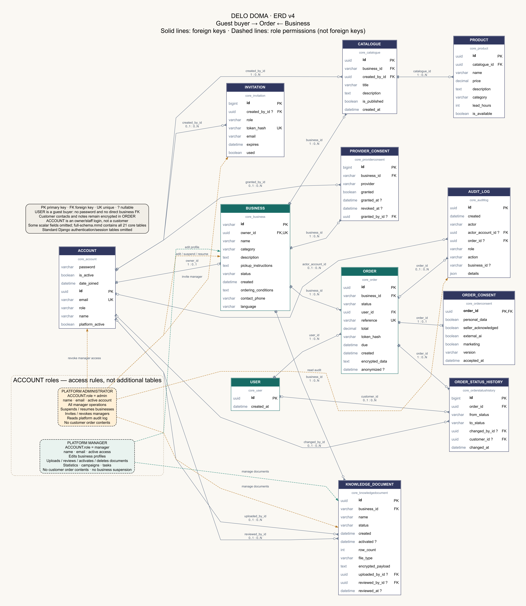

# ERD v4 — buyer, business and platform staff

This is the implemented schema of the active application in `/delo-doma 2`, not the historical nested copy.



- [Scalable SVG](delo-doma-erd.svg)
- [Editable Graphviz source](delo-doma-erd.dot)
- [All 21 core models and scalar fields, Mermaid](full-schema.mmd)
- [Role interactions, Mermaid](roles.mmd)

Solid lines are real foreign keys. Dashed green/orange arrows represent permissions, **not** additional database relations.
The main image shows the 12 entities relevant to the supplied diagram, with some scalar fields omitted for readability.
The full Mermaid source includes the inventory, campaigns, tasks, visits, sessions and rate-limit models as well.
Django's built-in permission/group/session/admin/migration tables and implicit auth M2M join tables are not drawn.
`generate.py` derives the physical fields and FK edges from Django model metadata.

## Identities and relationships

- `USER` (`core_user`) is a guest buyer with a UUID and creation timestamp, no password and no staff role. Each checkout issues a new guest identity; matching phone numbers do not merge buyers across businesses.
- `ACCOUNT` (`core_account`) is an authenticated owner, platform manager or administrator. It holds email, password hash, name, role and access flags. The three account roles share one table rather than duplicating authentication records.
- `BUSINESS.owner_id → ACCOUNT.id`. A business has one owner; an owner has zero or one business.
- `ORDER.user_id → USER.id` and `ORDER.business_id → BUSINESS.id`. There is **no direct USER–BUSINESS FK**.
- `CATALOGUE.business_id → BUSINESS.id`, `CATALOGUE.created_by_id → ACCOUNT.id`, `PRODUCT.catalogue_id → CATALOGUE.id`.
- The current owner interface maintains the default catalogue. The schema can hold multiple catalogues, but no multi-catalogue editor is included in this release.
- `ORDER_CONSENT.order_id` is both PK and FK. Normal checkout creates exactly one consent row atomically; the FK alone only enforces at most one row per order.
- `PROVIDER_CONSENT` stores the current consent for each `(business, provider)` pair, grant/revocation dates and the owner account. It is not an append-only consent history. Switching providers through the profile save path revokes the prior provider's consent.
- `ORDER_STATUS_HISTORY` records initial status and subsequent supported API transitions. `changed_by_id` points to an owner account; `customer_id` identifies guest creation/cancellation. A check constraint prevents both actors being populated at once.
- `KNOWLEDGE_DOCUMENT.uploaded_by_id` and `reviewed_by_id` identify the actual account performing the action.
- `INVITATION.created_by_id → ACCOUNT.id` identifies the administrator; only manager invitations are supported.
- `AUDIT_LOG.actor_account_id` and `order_id` are real FKs. `business_id` remains a textual audit scope (including the value `platform`), not a foreign key.

## Differences from the supplied image

These are deliberate adjustments for the confirmed guest-checkout workflow:

| Image concept | Implemented representation |
|---|---|
| USER login/password and business ownership | Moved to ACCOUNT; USER is exclusively the guest buyer |
| USER name, phone and email | Customer name/phone/notes remain only in the encrypted order snapshot; no duplicate plaintext customer directory |
| Integer IDs | Existing UUID identifiers retained for orders, products, accounts and documents; business ID remains a string |
| ORDER.encrypted_snapshot / notes | Existing `encrypted_data` includes the customer, product snapshot and notes |
| ORDER.due_at / created_at / anonymised_at | Existing names `due`, `created`, `anonymized` retained |
| PRODUCT.lead_time_hours | Existing `lead_hours` retained |
| BUSINESS.private_pickup_info | Existing `pickup_instructions` retained |
| KNOWLEDGE_DOCUMENT.file_name / encrypted_content / is_active | Existing `name`, `encrypted_payload`, and `status` (`active` etc.) retained |
| INVITATION.expires_at / status | Existing `expires` and `used`; expiry is derived from the timestamp |
| ORDER_STATUS_HISTORY.changed_by | Account FK plus a separate guest actor FK |
| Manager/admin boxes | Account role views, with explicit dashed permission arrows; not fake FK tables |

The order's decimal `total` is server-calculated and stored separately; the encrypted snapshot preserves order details.
No direct order-to-product FK was added: the confirmed reference diagram also stores the product snapshot inside the order.

## Permissions and actual interactions

| Operation / entity | Guest buyer | Business owner | Platform manager | Administrator |
|---|---|---|---|---|
| Public catalogue / products | Read published, available items | Maintain own catalogue | Read public catalogue | Read public catalogue |
| Business profile | Read public fields | Maintain own | Edit public profile of any business | Same as manager |
| Business availability | — | — | Cannot suspend/resume | Suspend/resume with reason and audit |
| Order / consent | Create; track/cancel with private token | Read/manage own business orders | No private order access | No private order access |
| Knowledge documents | No direct file access | Upload, preview, activate, delete own; import products | Upload, preview, activate, delete for any business | Same as manager |
| AI provider consent | Separate message/order consent | Grant/revoke for own business | Cannot change owner's consent | Cannot change owner's consent |
| Manager invitation/access | — | — | Cannot invite/revoke | Invite and revoke manager sessions |
| Audit log | — | Own business events | Writes own operation events, no global audit reader | Read platform events |
| Campaign / platform task | — | Own business campaigns | Platform campaigns and tasks | Same as manager |
| Analytics | — | Own business | Platform aggregates | Platform aggregates |

Manager document access is an intentional change from the previous README, authorized by the clarified requirements.
It does not grant private order access, the ability to change owner consent, or the ability to import/change product prices from documents.
Document upload sanitization, size/format validation and confirmation of permitted columns continue to apply.

Endpoints:

- `GET /api/operations`: business registry for manager/admin.
- `POST /api/operations`, `action=update_business`: public profile fields only; explicit `businessLanguage` is separate from the interface `language` field.
- `GET /api/platform_knowledge?business=...&id=...`: list/preview documents.
- `POST /api/platform_knowledge`: `upload`, `activate`, `delete` for the selected business.
- Existing `/api/admin` and `/api/staff` remain administrator-only.

## Fresh test database required

The user approved recreating disposable test data. The authentication model changed from the old `core.User` to `core.Account`, and the initial migration was regenerated.
**This is a fresh-install schema, not an in-place migration of the previous database.**

For local setup:

1. Stop the old application. Keep a backup of its SQLite file and `.local` encryption keys if needed.
2. Move the old `delo-doma 2/db.sqlite3` out of the application directory so Django starts with an empty database. Do not use `--fake` migrations.
3. In the active `delo-doma 2` directory, install `requirements.txt`, then run:

   ```sh
   python manage.py check_schema_baseline
   python manage.py migrate
   python manage.py createsuperuser
   python manage.py seed_demo  # optional, DEBUG only; accounts have unusable passwords
   ```

4. Build the frontend with Node 24: `cd frontend`, `npm ci`, `npm run build`.
5. Run the application. Create ordinary business accounts through signup; invite managers through the administrator UI.

For Render/PostgreSQL, point `DATABASE_URL` at a **new empty test database** before deploying this branch.
The startup guard rejects the old database schema rather than silently reusing migration history.
No live database has been reset or migrated by this change. No `.env`, encryption keys, local database or credentials are committed.
The nested historical copy is not changed and must not be used for this schema.

## Validation

- Django regression suite: 63 tests pass on SQLite, including nine new ERD/permission and startup-guard tests.
- Fresh initial migration applies successfully; `makemigrations --check --dry-run` reports no changes.
- `manage.py check` passes after the frontend build.
- Vite production build passes (existing bundle-size advisory remains).
- Browser smoke test: manager login, business selection, profile save and document preview work in the new section.
- Live PostgreSQL/Render deployment has not been tested or performed.

To regenerate text sources: `python docs/erd/generate.py` from the repository root with Django dependencies available.
To render the diagram with Graphviz: `dot -Tsvg docs/erd/delo-doma-erd.dot -o docs/erd/delo-doma-erd.svg` (or `-Tpng`).
